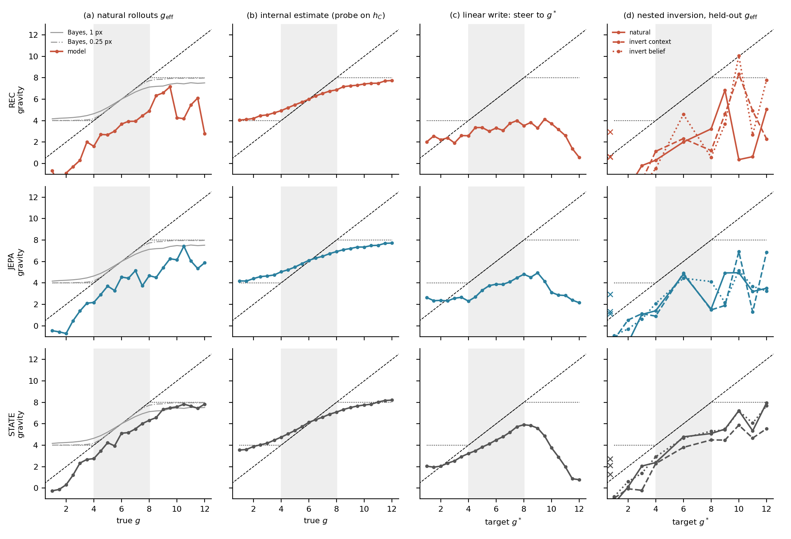

# VIBES: do video world models learn physics, or just vibes?

**A pre-registered, causal dissection of where world models fail to extrapolate a physical law.**

[Paper (PDF)](paper/main.pdf) · [Pre-registration v2](PREREGISTRATION_v2.md) · [v1 (the one that failed)](PREREGISTRATION.md) · [Overview in Russian (PDF)](docs/vibes_overview_ru.pdf) · [Submission checklist](docs/SUBMISSION.md)



---

## The question

World models watch a few frames, guess the physics, and predict the future. In distribution they
look great. Push one physical parameter outside the training range (here: gravity) and they fall
apart. Everyone has shown *that* ([Kang et al.](https://arxiv.org/abs/2411.02385),
[Physics-IQ](https://arxiv.org/abs/2501.09038)). Nobody has shown *where*.

So: when a model that infers gravity from context meets a gravity it has never seen, does it fail
because

1. its belief never represents that gravity (**inference**),
2. its dynamics cannot execute that gravity even if told (**execution**), or
3. it misreads the frames (**perception**)?

And is it even a failure? Spoiler from the theory: under squared loss the Bayes-optimal predictor's
implied gravity is the posterior mean, which lives inside the training range no matter what you
show it. Snapping back to the boundary is the loss doing its job. If a model extrapolates the law,
that came from an inductive bias, not from the objective.

## What we found

<!-- RESULTS_TABLE_START -->
(results table is generated by `python scripts/readme_table.py` after the grid finishes)
<!-- RESULTS_TABLE_END -->

Read the [paper](paper/main.pdf) for the full numbers with confidence intervals, the Holm-corrected
hypothesis table, and the limitations. Everything in the paper is generated from
`results/v2/summary.json` by `scripts/paper_tables.py`, so there is nothing to transcribe by hand
and nothing to fudge.

## How it works

**World.** A 2D box with 1-3 balls and blocks. Every episode draws its own gravity `g ~ U[4, 8]`,
restitution and friction. Materials are *visible* (the background tint encodes restitution and
friction); gravity is not visible in any single frame and has to be inferred from motion, which is
the honest version of the real world: rubber looks different from steel, `g` does not look like
anything. 20 fps, 64x64, 10 context frames, 20 predicted frames, 100k training episodes. The test
sweep goes `g = 1 ... 12`.

**Three families, one dynamics model.** A frame encoder is trained and frozen; a chunk world model
(GRU belief, MLP decoder for all 20 future latents at once) is trained on its latents. The families
differ only in the encoder's training signal:

- **REC**: pixel reconstruction (a keypoint autoencoder; the plain conv-AE never passed the competence gate).
- **JEPA**: latent prediction with an EMA target, VICReg regularized, no decoder.
- **STATE**: ground-truth positions, no velocities, no `g`. Perfect perception, same inference problem.

**Three gravity readings per model.**

1. *Natural*: what gravity the predictions exhibit (`g_eff`, curvature of predicted height, measured
   only where the reference trajectory is in free flight).
2. *Internal*: what a linear probe reads from the belief.
3. *Write*: steer the belief along a gravity direction and see what the dynamics execute. The
   direction comes from exact matched-state counterfactual pairs: conservative dynamics are
   time-reversible, so we can build two contexts that end in exactly the same state under two
   different gravities.

**Nested inversion.** A linear write can fail for boring reasons, so we also optimize the input of
the frozen model: the belief itself (tests execution), or the context latents fed to the frozen
belief network (tests reachability). We fit only the first 4 predicted frames and measure physics on
held-out frames. An anti-physics control (gravity pointing up) tells us how flexible the decoder is.

**Pre-registered.** Hypotheses, metrics, decision rules and tests were committed before any v2 model
was evaluated. Every deviation is dated and explained in `PREREGISTRATION_v2.md`. Version 1 of this
study (`PREREGISTRATION.md`) produced models that never learned physics; we kept it, because how
it failed is useful (Appendix A of the paper).

## Reproduce

```bash
pip install -r requirements.txt
```

```bash
python -m pytest tests -q
```

Generate every split (deterministic, about a minute):

```bash
python -c "import sys; sys.path.insert(0,'.'); from vibes import world; [world.ensure(k) for k in world.SPLITS]"
```

Run the whole grid (stage 1 encoders, stage 2 dynamics, evaluation; restartable; one GPU job at a time):

```bash
python scripts/run_v2.py --parallel 1
```

Aggregate, make figures, regenerate the paper's numbers and compile:

```bash
python scripts/aggregate2.py
```

```bash
python scripts/paper_tables.py
```

```bash
cd paper && tectonic main.tex
```

One model by hand:

```bash
python scripts/train_perception.py --kind rec --enc kp --seed 0 --out runs/v2/perc_kp_rec_s0
```

```bash
python scripts/train_dynamics.py --family rec --perc runs/v2/perc_kp_rec_s0 --seed 0 --steps 30000
```

```bash
python scripts/evaluate2.py runs/v2/dyn_rec_M_gru_train_100k_s0
```

Hardware used: one laptop GPU with 4 GB (RTX 3050 Ti). A stage-1 run is about 25 min, a stage-2 run
about 20 min, a full evaluation about 10 min.

## Layout

```
vibes/sim.py           exact-impact 2D physics (numba), energy/momentum bookkeeping
vibes/render.py        anti-aliased renderer with material tint (torch, GPU)
vibes/world.py         v2 splits, seeds, GPU pools
vibes/perception.py    stage 1: REC / JEPA frame encoders (conv, spatial-softmax, keypoint)
vibes/dynamics.py      stage 2: chunk world model (GRU or LRU belief + horizon decoder)
vibes/stage2.py        latent caches, readout decoder, stage-2 training
vibes/analysis2.py     uniform model interface, readouts, competence gate
vibes/experiments2.py  E1-E6: probes, natural sweep, Bayes reference, steering, nested inversion,
                       velocity edits, drift, OOD
vibes/readout.py       colour centroids and the reference-masked g_eff estimator
scripts/               grid runner, evaluation, aggregation (bootstrap + Holm), figures, paper macros
tests/                 simulator conservation, time reversal, estimators, readouts, model shapes
paper/                 ICML-style LaTeX, compiled with Tectonic
docs/                  literature check (all arXiv ids verified), submission checklist, Russian overview
```

## Related repos

Part of a from-scratch physical-AI series: [ARMageddon](https://github.com/nonberw/armageddon),
[YOINK](https://github.com/nonberw/yoink), [COPYCAT](https://github.com/nonberw/copycat),
[ZOOMIES](https://github.com/nonberw/zoomies), [LISTEN](https://github.com/nonberw/listen),
[SPUD](https://github.com/nonberw/spud).

## License

MIT.
